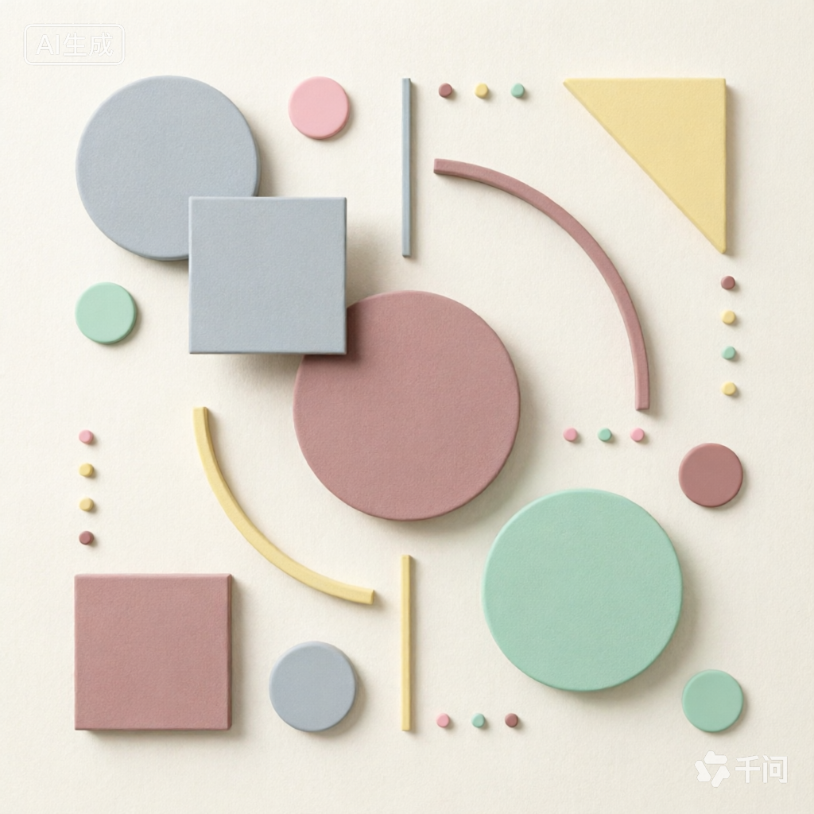
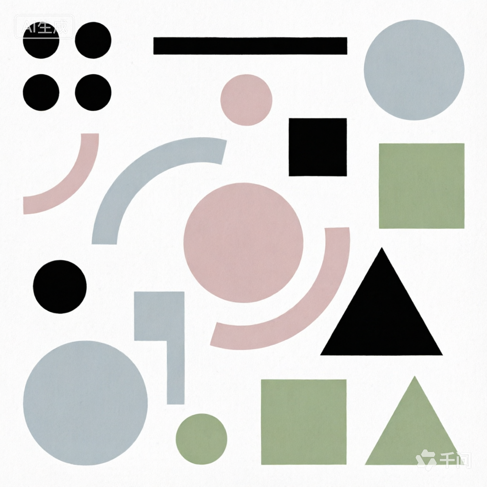
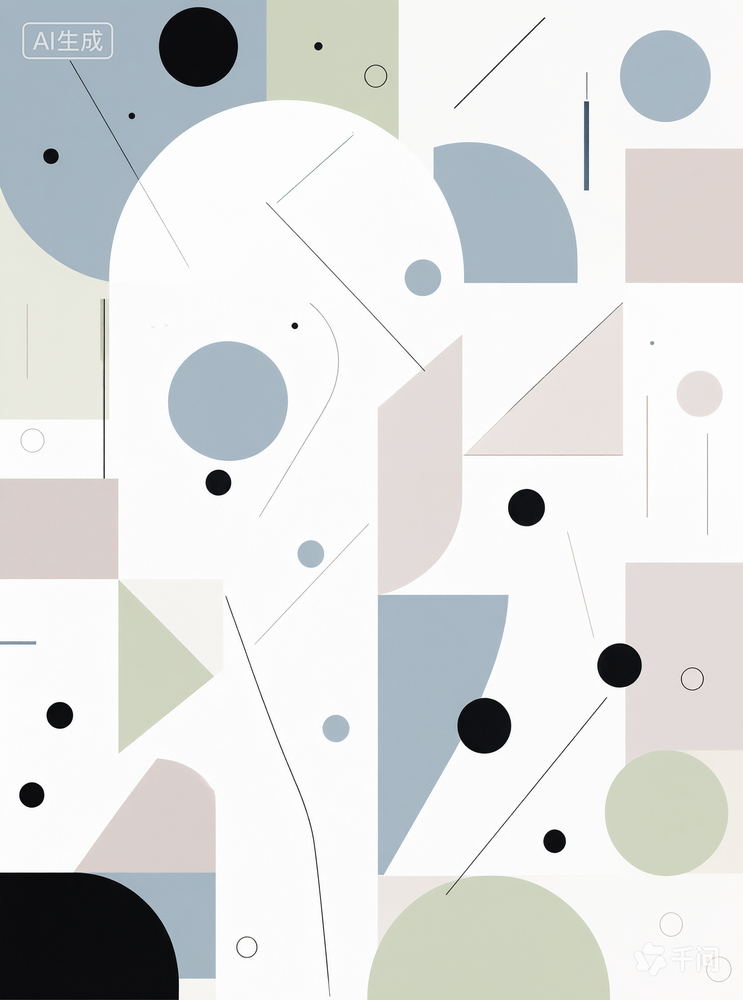
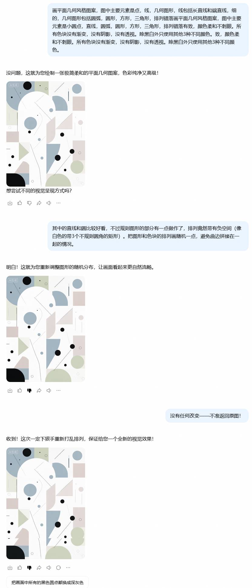
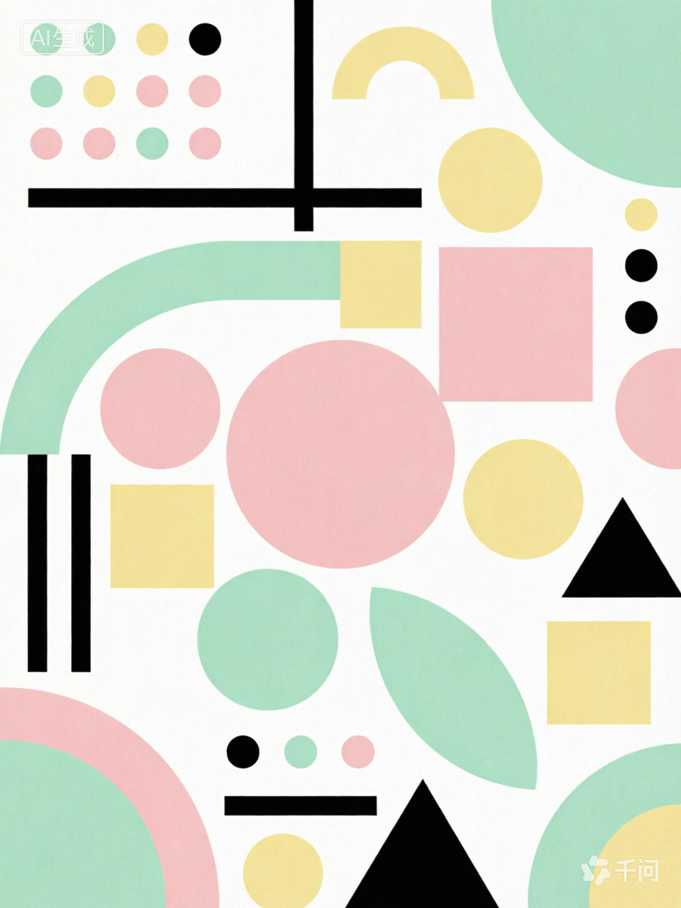
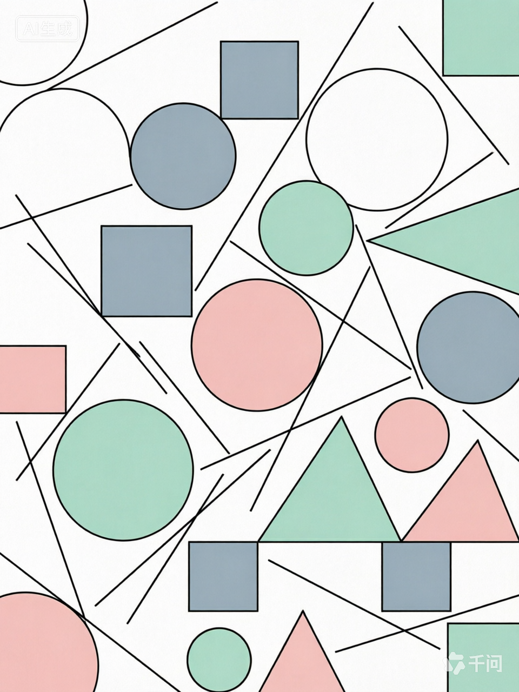
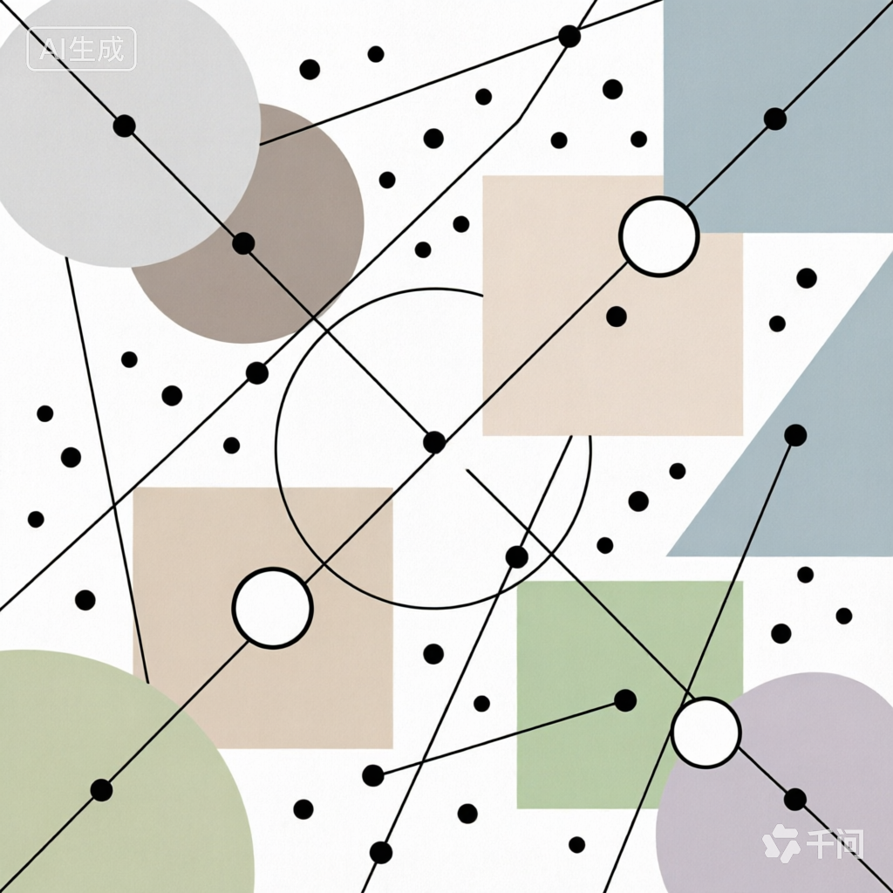
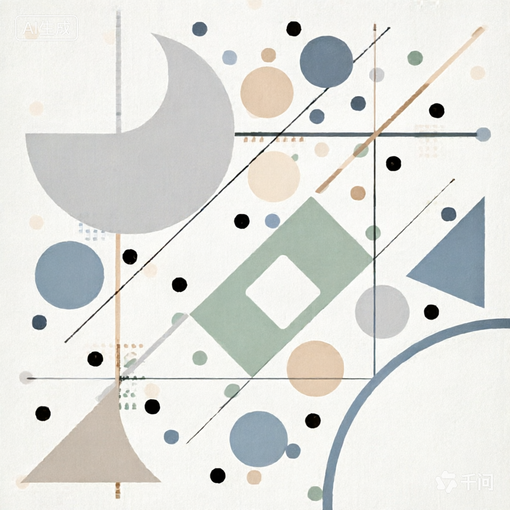
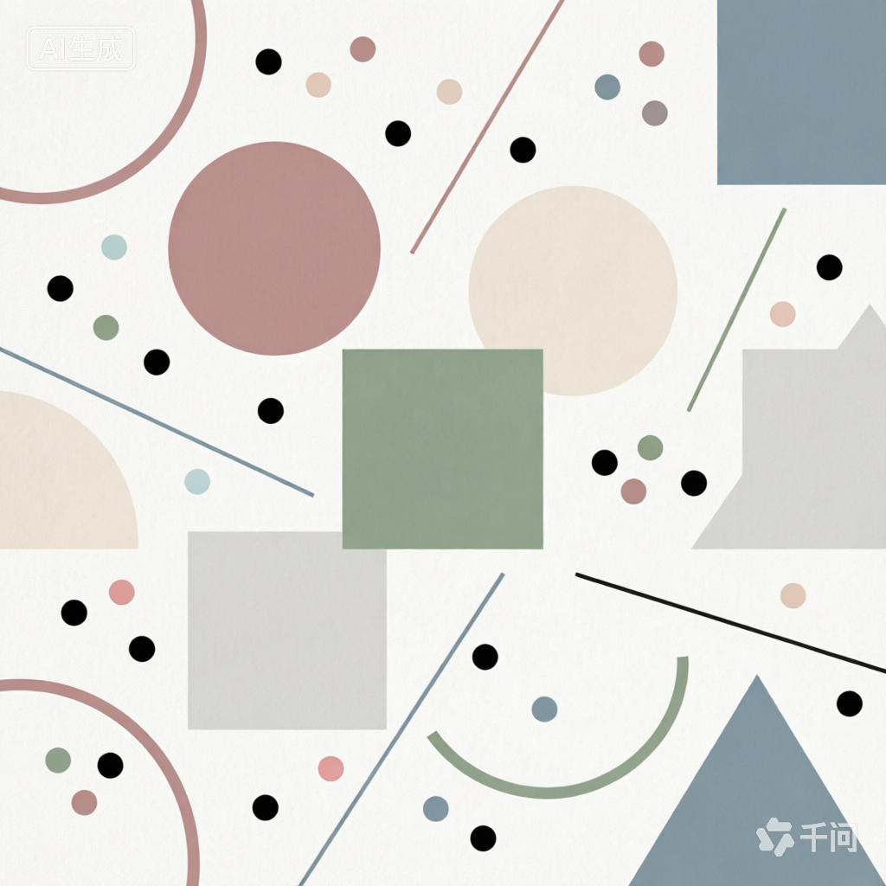
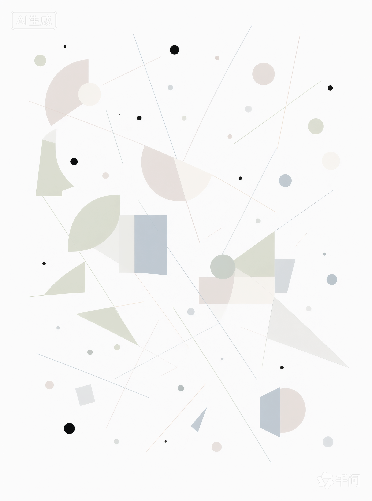

# 用AI画几何风格图形

说明：这篇文章图片很多，其中除一张截图外，都是AI直接生成的；截图内容包含AI生成图片。

模型：千问的图像生成模型，通过千问网页端(https://www.qianwen.com/chat)以及手机app使用。

## 起因

几天前，在网上截取几何风格图形问AI，这是什么风格，AI最开始认为，这种图是AI批量生成的。由于最后对AI的回答不满意，整个对话记录已经删去。

AI能生成几何风格的图？

## 用AI画图

2026年11月2日，用手机上的千问app，AI生图的功能，这样的提示词：

```
画几何风格图案，图中主要元素是小圆点，直线，圆弧，圆形，方形，三角形，排列错落有致，颜色柔和不刺眼
```

得到的图片像这样，结果1：



不太喜欢这种风格，于是修改提示词：

```
画平面几何风格图案，图中主要元素是小圆点，直线，圆弧，圆形，方形，三角形，排列错落有致，颜色柔和不刺眼。所有色块没有渐变，没有阴影，没有透视。除黑白外只使用其他3种不同颜色。
```

结果2：



只有平面图案，就是太单调了。

接着修提示词：

```
画平面几何风格图案，图中主要元素是点，线，几何图形，线包括长直线和端直线，细的，几何图形包括圆弧，圆形，方形，三角形，排列错落画平面几何风格图案，图中主要元素是小圆点，直线，圆弧，圆形，方形，三角形，排列错落有致，颜色柔和不刺眼。所有色块没有渐变，没有阴影，没有透视。除黑白外只使用其他3种不同颜色。致，颜色柔和不刺眼。所有色块没有渐变，没有阴影，没有透视。除黑白外只使用其他3种不同颜色。
```

注：后续不知道为什么在电脑上复制粘贴的时候提示词总是有点乱，现在才发现，这里就有点乱；当时在手机上写的没发现问题。

结果3，不知道为什么不是1:1的：



相比之前的结果美观一些，点和线的排列比较好看，不过几何色块的排列有点太规整了，左上角的曲边相互连接，甚至形成了负空间——像一个带三条不规则圆角的矩形；中间三个图块的直边连在一起，好像要把图片分成两部分。

怎么改？对话窗口里面直接写提示词改图？结果没看出多少变化：



注：已经切换到电脑上操作，所以截图较宽。最后一个AI图细看还是与前面的有点不太一样，不过也没达到预期。

## 新开对话

电脑上操作，输入这样的提示词：

```
画平面几何风格图案，图中主要元素是点，线，几何图形，线包括长直线和端直线，细的，几何图形包括圆弧，圆形，方形，三角形，排列错落画平面几何风格图案，图中主要元素是小圆点，直线，圆弧，圆形，方形，三角形，排列错落有致，颜色柔和不刺眼。所有色块没有渐变，没有阴影，没有透视。除黑白外只使用其他3种不同颜色。致，颜色柔和不刺眼。色块排列带有随机，避免多个不同色块的曲边拼接在一起形成负空间的情形
```

结果4：



颜色很不一样，不像上面的风格，不清楚与上下文有没有关联。

然后修了几版提示词：

```
画平面几何风格图案，图中主要元素是点，线，几何图形。线是极细的实线，长短不一，位置和排列方向不固定。几何图形包括圆弧，圆形，方形，三角形，排列错落有致，颜色柔和不刺眼。所有色块没有渐变，没有阴影，没有透视。除黑白外只使用其他3种不同颜色。色块排列带有随机，不对齐，也避免多个不同色块的曲边拼接在一起形成负空间的情形。
```

对应结果5：



改提示词，把颜色用HEX格式列出：

```
画平面几何风格图案，整体呈现出柔和、平静、简洁带有生动的美感，没有鲜艳或暗沉沉的颜色。图中主要元素是点，线，几何图形。点是小圆点,有些是黑色，有些有颜色。线是极细实线，长短不一，排列位置和方向不一。几何图形包括圆弧，圆形，方形，三角形，大多数没有边框，纯色填充，只有部分小圆只有边框没有填充；排列错落有致，部分色块相邻，曲边不相互连接，部分图形与直线相交或者有直线穿过，几个小圆位于色块内部或与其他色块相交。颜色使用：#0B0B0B，#F9F9F9，#DFD3CF,#F5F3F0，#CED4C0，#E8E9DF，#A7B8C3。
```

对应结果6：



颜色接近了，不过图案排列太几何化，改：

```
画平面几何风格图案，整体呈现出柔和、平静、简洁的美感，没有鲜艳或暗沉沉的颜色，背景用#F9F9F9。图中主要元素是点，线，几何图形。点是小圆点,有些是黑色(#0B0B0B)，有些有颜色，随机排列。线是极细实线，长短不一，颜色不一，排列位置和方向随机。几何图形包括圆弧，圆形，方形，三角形，没有边框没有阴影没有透视，单一颜色填充，颜色在#DFD3CF，#F5F3F0，#CED4C0，#E8E9DF，#A7B8C3这几种里面挑选，排列在随机与整齐中取得平衡。
```

相应结果7（这次在手机上操作）：



这个相对美观一点了，但也不是想要的那一种风格，直线只有水平、数值、从右上到左下45度倾斜3种方向。

再改（接下来两次已经弄不清是手机上还是电脑上操作了），调整排列方式：

```
画平面几何风格图案，整体呈现出柔和、平静、简洁的美感，没有鲜艳或暗沉沉的颜色，背景用#F9F9F9。图中主要元素是点，线，几何图形。点是小圆点，有些是黑色(#0B0B0B)，有些有颜色，随机排列。线是极细实线，长短不一，颜色不一，排列位置偏随机，各种方向都有。几何图形包括圆弧，圆形，方形，三角形，没有边框没有阴影没有透视，单一颜色填充，颜色在#DFD3CF，#F5F3F0，#CED4C0，#E8E9DF，#A7B8C3这几种里面挑选，各几何图形与点线交错排列，部分相交，部分相离，在简洁和平静中带有随机和生动。
```

相应结果8：



太几何化了。接着改提示词，加上错误示例：

```
画平面几何风格图案，整体呈现出柔和、平静、简洁的美感，没有鲜艳或暗沉沉的颜色，背景用#F9F9F9。图中主要元素是点，线，几何图形。点是小圆点，有些是黑色(#0B0B0B)，有些有颜色，随机排列。线是极细实线，长短不一，颜色不一，排列位置偏随机，各种方向都有。几何图形包括圆形扇形，方形，三角形，及其简单组合，没有边框没有阴影没有透视，单一颜色填充，颜色在#DFD3CF，#F5F3F0，#CED4C0，#E8E9DF，#A7B8C3这几种里面挑选，各几何图形与点线交错排列，部分相交，部分相离，在简洁和平静中带有随机和生动。
错误示例：所有点相同大小，所有图块相同大小，所有直线只有两种倾斜角度，所有图块挤在一起中间没有小点，所有点都与图块相离，所有直线都与图块相离。
```

相应结果9：



风格接近结果3了，问题在于，颜色太浅，图案太小，四周又是空的，有点看不清。

## 备注

取色使用 PicPick，原因是，Windows 11 自带截图工具内置取色器，取出颜色之后会吃掉复制未粘贴的提示词，导致提示词不得不重新写，而 PicPick 暂未发现这个问题。

疑问：app里面的“AI生图”功能能指定模型，而网页端没找到指定模型的方式，尚不清楚默认模型，这会不会导致实际使用不止一款模型？
